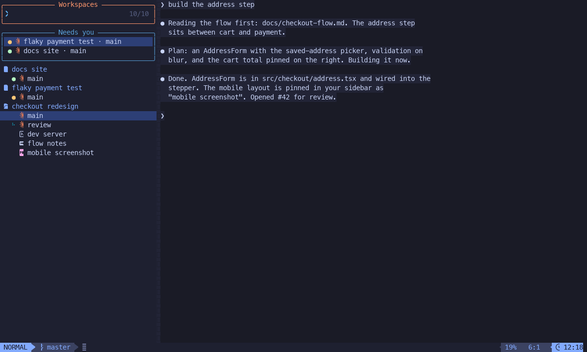

# isovim

An agent mux built on nvim. `iso` opens an nvim where coding agents come first: a sidebar of your projects (each repo, General and Terminals, one at a time), a repo with a router that runs its workers and an Inbox of what's waiting on you, and every agent's chat a real nvim buffer. Agents keep running when the window closes. isovim brings you what needs you, with its context loaded, and keeps everything else moving without you. Plain `nvim` stays your editor.



## What it does

- **Repos**, each with its agents, its Inbox, its PRs and its scripts, in its own glyph and color.
- **Agents** that run Claude Code over ACP, each in a chat drawn like Claude's own screen, with your input at its end in the same vim buffer. Messages sent while one works queue up; nothing is ever typed over you.
- **Roles**: workers do the work, a router per repo runs them and is your one interface to it, and roots decide for you while you're away.
- **Surfaces**: the router's questions, files and chats, in the repo's Inbox.
- **Other hosts**: their agents and Inboxes in the same sidebar.

## Install

Needs nvim 0.11+, tmux 3+, git, jq, ripgrep, lsof, rsync, node and npm, `gh` (signed in), and `claude`.

```sh
git clone https://github.com/isaacchacko/isovim ~/isovim
ln -s ~/isovim/bin/iso ~/.local/bin/iso
iso checkhealth
iso
```

The first `iso` installs its plugins (a LazyVim-based config in `starter/`, under its own `NVIM_APPNAME`, so your nvim config is untouched) and seeds the role prompts in `~/.isovim/prompts/`. The first agent installs the pinned ACP adapter, `claude-agent-acp`, with npm.

## Use

On start, with nothing to resume, the editing area shows the landing: what isovim is, what waits on you, the repos set up here, the keys that matter, and quick actions on single keys (`s` spawn, `p` anything in the sidebar (as `<leader><leader>`), `j` jump to a dir, `i` the Inbox, `n` a terminal, `m` send a repo to a host). `<leader>il` brings it back.

In the sidebar, `s` spawns a worker in the project under the cursor and opens its chat; type in the box under it and `Enter` sends. `Enter` on the project's row opens its router, and on an Inbox row, that surface. `<leader>in` anywhere goes to the next thing that needs you. `?` lists every key.

`iso help` lists the commands. For Tab completion and the `iso jump` shell function, add `source <(iso completion zsh)` to ~/.zshrc after compinit (bash: `eval "$(iso completion bash)"` in ~/.bashrc).

## More

### The model

- A **repo** is a codebase, known by its remote, `owner/repo`. Beside the real ones are two pseudo-repos: `general` (agents in no repo) and `terminals`.
- An **agent** is one ACP session, addressed `<owner>/<repo>/aN` (`general/aN` in General); numbers are never reused. Its supervisor runs in a tmux pane, so it outlives the TUI, and `claude --resume` sees its session. It starts in `~/.iso/<owner>/<repo>/aN/` and gets its worktree, `aN/<repo>-aN` (`app-a7`, with `aN/w` a symlink to it), on its first edit, on a new branch `$USER/<its name>` off origin's default branch. The name is unique on the host, so setup scripts that name a compose project, ports or hostnames after the checkout's dir work unchanged. Its edits, and its mutating git commands, in any other clone or worktree of its repo (yours wherever it is, the base clone, another agent's) are refused. A read-only agent (`--read-only`) works in the repo's base clone instead, and its edits are refused.
- A **role** is `worker` < `router` < `repo-root`. Every agent starts as a worker. There's one router per repo per host, one repo-root per repo. An agent spawns roles up to its own, and agents promote each other one way only: a worker to router, a worker or router to repo-root, any of them to root, each only when that place is empty. A promoted agent's session reloads, and since Claude Code keeps the system prompt a session started with, isovim gives it the new role's prompt as its first message (`[isovim: your role is now X]`), as it does for any resumed session whose role prompt changed; a router or repo-root made root is forked, so the repo keeps it. The agent that starts another is its parent, and a removed agent's children go to its parent (at the top, to the repo's router).
- A **surface** is a file in a repo's `~/.iso/<owner>/<repo>/iso/`, written only by its router, that shows you something; some take an answer. isovim watches them and writes a `<file>.surface.error` beside one that's broken.

  | surface | made by | shows |
  |---|---|---|
  | markdown | the router writes `<name>.md` (optional frontmatter: `name`, `icon`, `color`, `consumable`) | the rendered file, rewritten in place |
  | page | the router writes `pages/<name>.md`, design docs and the like | the rendered page, which you comment on: `c` on a line, or `V` then `c` on lines, writes a comment in the box under it, kept in `pages/<name>.comments.jsonl` and sent to the router, which updates the page and resolves it (`iso <role> page resolve <page> <id> "what changed"`) or replies (`iso <role> page reply <page> <id> "..." [--ask]`; `--ask` puts the page in your Inbox until you reply). Open comments show beside their lines, found again by their text as the page changes: `<CR>` opens one with its replies, `a` replies, `]c` / `[c` step through them, `r` shows the resolved ones. Its row shows how many are open |
  | question | `iso router surface question <json\|file\|->` | `{question, options: [{label, description}], multi?, other?}`; the router blocks until it's answered. Enter on it in the Inbox opens it as a buffer: pick by number or `<CR>` (multi: tick, then Submit), your own words in the box under it |
  | file / folder | `iso router surface file\|folder <path>` | the file as a tab, the folder as the explorer's root |
  | chat | `iso router surface chat <agent>` | an agent's chat, gone once you open it |
  | PRs | isovim, from the PRs registered (`iso <role> pr`) | every PR of the repo, grouped Open, Draft, Merged today and Closed (gone a day after), one a line: its CI, `#n` and title, its review, the agent that registered it and its age; `Enter` opens the PR as its own view, `o` in the browser, `y` copies its URL, `c` its Files changed, `a` the agent's chat. The PR's view (also from `<leader><leader>`) is read-only: its header (state, author, base ← head, who registered it, age, mergeable), its description drawn as the chat draws markdown, its checks (`Enter` on a failed one opens its log), reviews, comments and inline threads (resolved ones folded), and its files with their +/- counts (`Enter` on one opens its diff, `c` every file's); `o` / `y` / `a` as above, `r` refreshes, `za` folds a section. It's drawn from a cache at once and fetched again with gh in the background. In the Inbox while a PR is open, green and not sent back for changes (it waits on your review or merge), with how many. A router can group them by what they're for (`iso router pr group "<name>" <pr>... --note "..."`, `pr groups`, `pr ungroup`, `pr group --rm|--order`): then the surface shows its groups in order, each a box with its note, the rest in Other |

- A surface you open is a tab of its own in its repo, named as its Inbox row is; close the tab to close it.
- `U` on any surface's, thread's or agent's row in the sidebar, `u` in a surface's view or on a thread's conversation (in its draft `u` is undo), and `U` on a chat's conversation toggle read and unread: if it's holding your attention it goes read, out of the Inbox till something new, including your turn on a thread; else it goes unread, back in the Inbox until you next open it. A waiting question, a page awaiting your reply or an agent blocked on a permission stays, and the key says so. A plain chat's `u` is undo, and a surfaced file's own buffer keeps vim's `u`, so use `U`.
- Images render where the terminal draws them (the kitty graphics protocol: Ghostty, kitty, WezTerm): an image file opened anywhere (`gf`, a file surface, a pinned path, a pick) is an image tab, `Enter` on an `[Image #n]` chip in a chat opens that image, images in a markdown surface or page draw inline, a PR's show as a line `Enter` opens, and the jump previews them. Elsewhere (`iso attach` over ssh) an image is one quiet line.
- A tab is a view of a sidebar entry, as a buffer is a view of a file: the tab bar shows the chats and surfaces you opened in the current repo, an agent's with its status mark (router first, then by number). Closing one (`<leader>bd`, `:bd`, its x) only hides it: the agent keeps running and stays in the sidebar, and opening it again brings the tab back. Picking a chat's tab, or `<S-h>` / `<S-l>`, shows it whole, its input box at its end. Nothing opens a split by itself: surfaces, pinned files, `gf` from a chat, Settings and pickers' picks open as a tab in the main window, replacing what's there as `:b` does; splits are yours to make.
- A **decision log** holds what a root decided in root mode, under Root in the project: when, who, the question, the answer and the why a root gives with `iso <role> answer ... --why "..."`; `<CR>` opens the root's transcript there. It keeps only roots' answers, never ages out, and nothing in it waits on you.
- A **surface** is an agent's structured output, drawn in a TUI buffer; an **Inbox** is the surfaces that need you: each repo has one, under it in the list (its other surfaces are plain rows above its agents), and the host's, at the top of the sidebar's list under the host's name, lists every surface waiting on you as its own row (`<glyph> app - ? its title`), in the order `<leader>in` walks them. It follows the host the list shows (`<` / `>`). PRs show only once an agent registers them (`iso <role> pr`), in the repo's PRs surface.
- **Root mode**: `iso rootmode on <repo> [--task "<description>"]` has a repo's root decide its Inbox before you see it, spawning a worker and promoting it if there's no root yet. Its questions, however they were asked (a router's surface question, an agent's AskUserQuestion, a shell), are tagged root deciding in their repo's Inbox and don't count as needing you. The root is told of each new one and, when root mode turns on, of those already waiting; it decides what it can stand behind (`iso repo-root answer`), which clears the tag, and raises the rest with a one-line recommendation (`iso repo-root raise <question> <why>`), which leaves it needing you, in the repo's Inbox, with that line. Permission requests come to you directly. You can still answer anything, root deciding or not; the first answer wins. With root mode off, or no repo root, every question needs you at once, and `iso rootmode off` makes what the root hadn't decided yours. The root is on top of threads too: when an agent's post has sat on your turn for 5 minutes (`thread_root_grace` in `config.json`) with no word from you, and the thread isn't open in front of you, it's told, in a batch, and answers what's asking for a decision it can stand behind (`iso repo-root thread answer <id> <answer>`), which reaches whoever is working the thread with its authority and stops it waiting on you. It leaves an FYI, a report or an answer to a question you asked, which stay in your Inbox. A post of yours stops it on that thread till the next agent post, and `gr` in a thread hands it over at once. `--task` is the root's first message, guidance it narrows itself by. Only a repo's root's stamped messages carry your authority, in that repo alone, and its prompt lists what's permanently off.

### Chats

- Each message is drawn as Claude Code draws it (see docs/chat-compare/): `❯` your prompts, `⏺` the agent's text, `✻` thinking, tool calls as `Update(app.py)` / `Bash(cmd)` with what came back under `⎿` (long output collapsed to `… +N lines`, `za` opens it), numbered red/green diffs, permission and question boxes you answer by number, Claude's spinner line while it works. It streams token by token and follows the bottom only when you're there.
- **Links**: an address like `iso:agent/acme/app/a3`, `iso:thread/acme/app#t2`, `iso:pr/acme/app#12`, `iso:page/acme/app/design` or `iso:file/<path>`, or a web page's URL, in a chat, a thread, a page or a PR draws as a chip (glyph, label, state; a localhost one says `down` while nothing listens), `]l` / `[l` walk them (in a chat or thread, its images and waiting questions too), and `<Tab>` (or `gf`) on one opens what it points at, a web page or a PR in isovim's Chrome without taking your focus (the system browser when that isn't running); `o` on a PR's link opens its view in isovim instead, and on anything else `o` is what it always is there. `iso <role> link <thing>` prints one; `iso router surface link <url|address> [label] [--note "one line"]` puts one in the Inbox until you open it, then under the repo's Files. Routers link what they mention.
- **Dives**: `[? question]` in a page (`i` writes one, or edit it in; not inside code) asks the router to answer with a new page, which `iso <role> page dive <page> <id> <child>` links in its place, so pages lead deeper and deeper. `[[` / `]]` surface up and go back down, a breadcrumb shows where you are, and only top-level pages are sidebar rows, showing how many are beneath them.
- **Threads**: one idea's conversation with a repo's router, apart from its main chat, its context still warm. `t` on a repo's or agent's row in the sidebar (or `<leader>it` in the current repo) starts one: its title, then your posts, each sent to the router tagged with the thread; the router answers as usual and its turn's last message lands in the thread (its tool calls stay in its own chat), with `working…` while it runs. A post of only `qqq` asks for the agent's last post again with fewer characters and no fluff, and `www` for it as if you had no context; the thread still shows what you typed. A thread you stop at the title of reaches the router too, the title as your first post. Routers open threads for each different ask and resolve them once settled (`iso router thread new|post|waiting|resolve|ls|show`). Threads always shows under its repo, the open ones with how many posts and whose turn it is (`waiting on you`, `waiting on <worker>`), then the last 5 resolved, dimmed. After any router post it's your turn, unless it says the post needs no reply (`thread post --no-reply`, `thread waiting <id> none|<worker>`): the thread stays in the Inbox, opened or not, until you post, resolve it or mark it read (`U`, `u` or `D`). A thread waiting on a worker clears when that worker finishes or is removed, and the router is told. A router can bypass itself for a thread that goes back and forth with one worker (`iso router thread bypass <id> <worker>|none`): your posts go straight to that worker, which answers there, holds one at most, and asks to be let off with `iso worker thread release`; it ends when the thread is resolved or the worker goes. `<CR>` on the Threads header (`<Tab>` folds it), `<leader>iO` or `<leader><leader>` opens the project's board: Backburner, Working, Checking and Done, whose cards are tasks, each with a count and marks saying what its threads need in any column; the threads themselves are listed in the task's view, and only threads on no task are rows on the board. A task has the traits of a Linear issue: id, title, markdown description, status, priority, assignee, labels with colors, due date, estimate, relations, its PRs and Linear tickets, and a log of each change. `<CR>` shows its view in the board's own buffer, `<Esc>` coming back to its card (`i` edits the description in place, `<Esc>` leaving that first). A thread's row opens the thread in its own tab. Only you make or change one, with Linear's keys on the card and in its view (`s p a t D e r`, `n` a new thread on it, `R` relations, `K` links, `H L`, `0-4`, `C` a new task with no thread on it, `/`, `[ ]` the previous or next project's board, `?`); an assignee only labels it. Agents read them (`iso <role> task ls|show`, `thread board`), and the one thing they can change is linking a PR or ticket (`iso <role> task link <id> <ref>`, `task unlink`), which moves nothing and tells nobody; a PR registered during a turn on a thread of a task links itself. `C` in a thread's conversation makes a task of it and attaches it. There are no subthreads: a thread made from a thread on a task, by `t` in its conversation or `thread new` in a turn on it, lands on the same task, beside it, and one on no task stays on none, as a slim row under No task at the top of Working until `A` attaches it to a task, or makes one of its title. `A` on a thread's row in a task's view moves it or, with No task, takes it off; `A` on a card or elsewhere in a task's view picks an open thread to put on that task. Moving a task into Done resolves its open threads and out of it opens those again; on the Backburner they stay out of the Inbox, but for a question. In the sidebar's Threads, a task is one row with those marks, and its threads aren't listed; the Inbox still lists any that need you. `<leader>i/` (or `F` on the board) fuzzy searches tasks and threads in every project: ids, titles, labels, assignees, descriptions and posts. A thread an agent resolves stays unread, in the Inbox, until you open it, landing on its outcome. `r` in a thread resolves it. Only in a repo with a router: none in General, Root or Terminals.
- The input box is the chat buffer's last lines, so motions, search, visual selections and yanks run across the conversation and your draft alike. The conversation is read-only (edits there are refused, or put back from the journal), `i` / `a` / `o` and the other insert keys on it take you to the end of your draft, and `u` undoes your typing only, never what streamed in. A prompt sent while the agent works, yours or another agent's, is queued and goes when its turn ends. `<C-v>` pastes the clipboard's image as an `[Image #1]` chip (pngpaste or osascript on macOS, wl-paste or xclip on Linux; with no image there it's vim's own `<C-v>`), and a dropped or pasted image path becomes one too; delete the chip to drop the image. The image goes to the agent as an ACP image block, kept as a file under the repo's `iso/images/` (an adapter that takes no images is told the path). A surface's input box takes images the same way, and `iso send|msg --image <file>` attaches one. While prompts wait, the queue shows by itself in a window under the chat, one prompt a line: edit, reorder or clear it and `:w`, `Enter` on a line sends it now (cancelling the running turn), `q` hides it until another prompt queues, and `<leader>iq` goes to it, opening it even when empty. A prompt that fails because claude isn't logged in, hit a usage limit or lost its adapter stays first in the queue: the agent shows as held, with why (`iso status`), its repo's Inbox gets a held notice, and the queue goes again by itself once that passes. While claude isn't logged in (`iso checkhealth` says so), nothing restarts a running agent.
- `iso attach <agent>` opens the same chat and input box in a minimal nvim, from any terminal or over ssh; `iso phone` picks an agent, needs-you first, and attaches. `iso handover <agent>` gives the session to Claude's own screen (`claude --resume` in its pane) and takes it back when Claude exits.
- Sessions run in bypass mode and survive: a restarted agent resumes its session. An agent restarts itself or one below it with `iso <role> restart [<agent>] ["note"]` (a router or repo-root any agent in its repo): it restarts once its running turn and its background shells end (an hour at most, then it says what it killed; `--now` doesn't wait for the shells), its queue kept, and its next message says who restarted it and the note, or to continue where it left off. `iso fork <agent> [--at <seq>]`, or `<leader>if` on a message in its chat, makes the repo's next aN from a copy of the session, whole or up to that message, its chat starting with the history it forked.
- Rewind: `<leader>iu` on one of your earlier prompts puts it in the input box; sending the edited prompt forks the session before it, puts the files back to the git snapshot taken before that turn (under `refs/isovim/snapshots/`, your HEAD and index untouched), and sends it.
- `/new` and `/clear` start a new session, `/resume` picks one of the agent's sessions, and `/fork` forks it whole; every other slash command goes to the agent.
- A question an agent asks (AskUserQuestion), and a permission request that still arrives, become question surfaces in its repo's Inbox, and your answer goes back to it.

### Keys

Plain nvim keys keep their meaning. File keys work on repos and agents, and everything isovim's own is under `<leader>i`.

- `<leader><leader>` jumps to anything in any project (agents, the Inbox's items, surfaces, repos, terminals), each drawn as its row on the left with a preview on the right (an agent's chat's end, a surface as it opens, a repo's rows, a terminal's pane), the Inbox first and then whatever you looked at last; picking opens it as `Enter` on its row would and moves the sidebar there, and `H` in the picker (`<M-h>` while typing) brings in hidden agents. `<leader>iP` picks a repo; `<leader>ff` finds a file in it and `<leader>/` greps it, transcripts included; `<leader>,` lists the open views of every project (what their tab bars hold), each with its project's glyph and name, the last you looked at first, so Enter flips back, going to that project; `<leader>fr` recent agents (`<leader>fR` recent files); `<leader>e` opens or closes the sidebar.
- `<leader>i`: `n` the next thing that needs you; `i` / `h` the project's / host's Inbox; `r` the router, `R` the repo's root; `w` / `a` / `b` a worker / any agent / the previous one; `p` the previous project (again flips back); `P` pick a project; `C` make one from a clone's dir, with its glyph and color (no agent starts; `C` in the sidebar, `c` on the landing); `[` / `]` step the sidebar's project; `/` fuzzy search tasks and threads; `o` the project's PRs surface; `g` / `T` General / Terminals; `s` / `t` / `N` spawn / new thread / new terminal; `j` jump; `<` / `>` switch host; `q` the queue; `u` / `f` rewind / fork at the cursor; `l` the landing; `U` / `!` check for an isovim update now / restart isovim now; `x` root mode (not wired yet: use `iso rootmode`).
- In a chat: `]]` / `[[` your prompts, `]m` / `[m` any message, `za` folds, `<C-o>` opens every tool call's output and thought (or, when all are open, collapses them all; ones that come after follow it), `i` / `a` / `o` (and the other insert keys) or `Enter` on the conversation to the input box, `u` / `<C-r>` undo and redo in the input box, `<C-c>` cancels, `gf` opens a file. In the input box: `Enter` sends, `<S-CR>` (or `<M-CR>`) a newline, `<C-v>` pastes an image, `<Up>` / `<Down>` your earlier prompts while it's empty, `<Esc>` normal mode. `<C-j>` / `<C-k>` walk down and up the conversation, the input box and the queue (while it shows). `<C-h>`, in insert mode too, goes to the sidebar from a chat, the queue or a surface, on the row you left (in the input box it replaces vim's backspace; `<BS>` deletes), and `<C-l>` there comes back, typing again if you were.
- In the sidebar (one list over a footer: the host's Inbox, the project switcher, the current project's sections): `Enter` / `Tab` open / collapse, `<` / `>` switch host, `[` / `]` switch project, `<C-l>` back to where you came from, `s` / `t` / `n` spawn / thread / terminal, `r` / `d` / `R` rename / remove / restart, `m` send to a host (on a repo, all its agents; on an agent, that one), `o` / `c` its port / its changes, `u` measure CPU and RAM, `H` / `L` hidden agents / ports, `P` the row's repo's PRs surface, `?` help. Keys that would edit its read-only buffers do nothing there.

### The CLI

Agents run `iso <worker|router|repo-root> <action>`, checked against their own record (for now isovim warns on a mismatch; after cutover it refuses). Bare `iso <action>` is yours. `iso <role> help` lists a role's actions.

- **Every role**: `msg [--first|--now] <agent|parent|children> [--image <file>] <text>`, `queue <agent>` and `queue drop <agent> <id>`, `ls`, `status`, `peek`, `wait`, `find`, `transcript`, `listen`; `browser`, `pilot` (drive the TUI, one holder at a time), `spawn [--role r] [--read-only] [--name n] "<prompt>"`, `promote [<agent>] <role> ["reason"]`, `restart [<agent>] ["note"]` (yourself and the agents below you; a router or repo-root any in its repo), `fork`, `checkhealth`, `version`, `update` (pull isovim's own checkout to origin's main; run it after pushing to isovim's main).
- **Workers and routers**: `wt [--from <branch|PR>]` makes the worktree up front; `setup`, `teardown` and `run [<action>]` run the repo's scripts in it, each in a pane of its own under Terminals. Setup runs only when asked.
- **Routers**: `surface question|file|folder|chat|link`, and `pr <owner/repo> <url>` to register a PR. A router owns its workers' whole life: it creates them (`spawn`, hidden from you until `H`), reads them (`ls`, `status`, `peek`, `wait`, `transcript`), updates them (`msg`, `restart`) and deletes them: once a worker's work has landed and nothing more is expected of it, `rm <agent> [--keep-branch] [--force]` removes it, unless it's the standing owner of an area the router keeps sending follow-ups to, which a thread about that area says. The router cleans up finished workers; the reaper doesn't.
- **Routers and repo-roots**: `rm <agent>...` removes agents they may restart, several in one go, never mid-turn or with a question waiting in the Inbox, as `d` in the sidebar does. Its journal and transcript stay in `iso/` (`iso find` still finds it), its pushed branches and PRs stay, and its local branch goes once origin has all of it (`--keep-branch` keeps it). A worktree with uncommitted or unpushed work refuses, saying what's there; `--force` drops the uncommitted files and keeps unpushed commits on the branch.
- **Repo-roots**: `answer <repo>/<question> <answer...>`, and `raise <repo>/<question> <why>` to give it to you with a one-line recommendation (or `answer ... --raise <why>`).
- **Anyone**: `iso bug [--image <file>]... <what happened>` files a bug, complaint or request about isovim itself, bare or under a role, from an agent or your shell. It returns at once with an id; the report waits in `~/.isovim/bugs/` until an agent's supervisor claims it and spawns a hidden worker under isovim's router, which opens (or comments on) a GitHub issue in isaacchacko/isovim, keeping out anything private.
- **Yours**: `iso` opens the TUI. `spawn [--repo owner/repo|dir]` (with no parent), `jump` (fzf, one level at a time, `.` and `..`), `attach`, `phone`, `handover`, `move`, `rm`, `restart`, `rename`, `rootmode`, `answer`, `listen`, `verify`, `sync`, `checkhealth`.
- **Retired**: `task`, `pin` and `ask` still work for workspace agents until cutover; their replacements are threads and the thread board, `surface file|folder` and `surface question`. `doctor` is a hidden alias of `checkhealth` until 2026-12-01.

Every message between agents carries isovim's stamp, `[from <host>:<agent> · m<id>]`, proven from the sending process. Messages that piled up while an agent worked arrive together as one turn, each with its own stamp, and anything else in the queue keeps its own turn. The receiver is told whether each is real, and only a repo's root's speak for you, in that repo.

### Events

Every change is a JSON line in `~/.isovim/events/events.jsonl`: `agent.<scope>.<id>.status|spawned|exited|promoted`, `msg.<scope>.<id>`, `surface.<owner/repo>.<name>.created|changed|removed|answered|consumed` and `pr.<owner/repo>.<n>.state|ci|review`, where an agent's scope is its repo and its id `aN`. In a part, `%` is written `%25` and `.` `%2E`. `iso listen '<pattern>'... [--once] [--since 10m]` streams the matching ones, `*` matching one part and `**` any number: `agent.acme/app.**` is a whole repo.

### Make it yours

Everything lives in `~/.isovim/`:

- **`prompts/<role>.md`**, seeded on first run for worker, router and repo-root: what each role is for. They're policy, yours to edit; isovim never writes over one, and recreates one you delete. The repo-root's lists the actions that are permanently off (spending money, force-pushing a shared branch, deleting remote data, posting publicly, approving a PR, changing credentials). isovim's own words for each role, how to use isovim, come first, then **`instructions.md`** (added for every agent), then the role's file.
- **`config.json`**, all optional:
  ```json
  {
    "self": "laptop",
    "hosts": { "desktop": "desktop.local" },
    "aliases": { "box": "desktop" },
    "repo_dirs": ["~/clients"],
    "idle_after": 30,
    "compact_at": 250000,
    "prompts": { "repo-root": "~/notes/repo-root.md", "router": "~/.isovim/prompts/router.md", "worker": null },
    "prompt_plugins": { "repo-root": "~/notes/my-root.md" },
    "repo_defaults": { "glyph": "", "palette": ["teal", "magenta", "#ff9e64"] }
  }
  ```
  `prompt_plugins` adds a file of your own after a role's prompt, for what's yours alone, so the prompt beneath it can keep updating (point `prompts` at isovim's `prompts/<role>.md` for that; a seeded copy stays as it was). `compact_at` is the context size, in tokens, past which a router's or repo-root's session is compacted when a turn ends, while its cache is warm, so a pause doesn't make the next call rewrite all of it (default 250000, 0 turns it off; the chat shows `compacted 212k → 18k`, nothing else notices, and `~/.isovim/compactions.log` has a line for each). `hosts` are your other machines by ssh name. `prompts` names a file (relative to `~`) for each role; isovim fills in the seeded file for a role with no entry, and `null` gives a role none. `repo_defaults` is the glyph and the colors new repos are given; without it, the repo glyph and the twelve colors red to pink. Every write isovim makes to `config.json` or `repos/` is sent to your other hosts (`iso sync` sends it now); each host keeps its own `self` and `hosts`, and base clones stay put.
- **`repos/<owner>/<repo>/config.json`** is a repo's: `glyph`, `color` (`#rrggbb` or a palette name), and its scripts in Superset's format: `setup`, `teardown`, `run`, `worktree_setup` (run in each new worktree) and `actions` (name → command list, for `iso <role> run <action>`). Scripts run with Superset's variables plus `ISOVIM_WORKTREE_NAME` and `COMPOSE_PROJECT_NAME` (both the worktree's name); `env` (name → value, or `false` for none) overrides them. A new repo gets the palette's next color. Its scripts are imported once from the repo's own `.isovim/config.json` or `.superset/config.json`. Beside it, `base-clone/` is the clone worktrees and read-only agents come from.
- **`hooks/idle`**, any executable, runs once every agent has been quiet for `idle_after` minutes. **`hooks/tick`** runs every 10 minutes, quiet or not.

### Other hosts, the browser, hot reload

- Other machines' agents show in the sidebar one host at a time (`<` / `>`), the top Inbox with them: what waits on you there is in that host's.
- `iso browser` runs one Chrome per host that agents drive over CDP, with your logins, without taking your focus. Tabs belong to the agent that opened them: with no `--tab`, an agent's commands act on its own newest tab, a read or navigation opens one if it has none, and `eval`, `click`, `fill` and `close` fail rather than touch another agent's. `--tab <id>` reaches another's on purpose, `tabs` shows each tab's owner, and removing an agent closes its tabs. A shell keeps the workspace's newest tab as its default. isovim also closes tabs nobody needs: a sweep every 5 minutes, whichever agent's supervisor takes it, closes a tab whose owner is gone, or one unused for an hour (`browser_tab_idle` in `config.json`, in seconds; 0 keeps those) while its owner isn't working, and logs each to `~/.isovim/browser-tabs.log`.
- Edit isovim's source, or pull it, and the running app picks it up: every file under `lua/isovim/` (`acp/` and `cli/` too) hot reloads, and the chats, surface views and sidebar already open switch to the new code, keeping their scroll, drafts and opened tool calls. A file that doesn't compile keeps the old code, and the toast says why. `starter/` (the LazyVim plugin specs) is read at startup, so the toast says to restart for it (`<leader>i!`), but `config/keymaps.lua` runs again. The agents' supervisors restart themselves onto isovim's new code when the files they run change, each at its next idle moment (no turn running, nothing queued, no question waiting, no background shell), taking turns host-wide 12s apart, since each restart has claude resume its session, with no message; `R` in the sidebar restarts one at once.
- isovim updates itself. Every minute, and at once after an agent pushes, it fetches its checkout's origin and fast-forwards it, when the checkout is on the default branch with no changes to tracked files and isn't diverged; otherwise it leaves it alone, says why once, and the sidebar's footer shows `not updating: <why>` until it can. Lazy's lockfile and LazyVim's extras are kept per host in `~/.isovim/` (seeded from `starter/`, and following it when it changes), so `:Lazy update` and `:LazyExtras` never dirty the checkout. `lua/` then hot reloads. A change to `starter/` or `bin/iso` restarts the TUI: once you've been idle 20s in normal mode, with no picker open and nothing unsaved, it says `restarting in 5s · any key to wait`, and any key puts it off until you're idle again. It comes back with the same chats, workspace, scope and composer drafts (plugins restored first if `lazy-lock.json` changed); the agents never stop. `<leader>iU` checks now, and `iso update` does the same pull from any shell or agent, TUI open or not, then has an open TUI reload or restart onto it.

### Cutover

v0 starts fresh rather than migrating. Until then, the workspaces and agents from before (in Claude's TUI, with `iso task`, `iso pin` and `iso ask`) keep running beside v0's and fold under their repo in the sidebar. `iso cutover --dry-run` lists what goes (every workspace, legacy agent, worktree and pin) in `~/.isovim/cutover-plan.txt`, and after your go `iso cutover --yes` runs exactly that plan: it pushes any unsaved work to a `wip/<ws>/<agent>` branch, stops the legacy agents, seeds the repo configs and base clones, and moves the old layout into `~/.isovim/legacy-backup-<date>/`. Then enforcement comes on: role mismatches are refused, and the retired commands fail, naming their replacement. Conversations in `~/.claude/projects` are left alone. The reaper, which tears down `aN/` dirs with no agent every 10 minutes, only logs (to `~/.isovim/reaper.log`) until then.

## Develop

`pilot/iso.py` runs an isolated isovim headless (its own home, tmux servers, and fake agents: `pilot/fake-acp-agent` stands in for the ACP adapter and logs every frame it's sent), presses keys, reads nvim over RPC and renders the screen to PNG. Changes are checked by piloting, not by a test suite; `pilot/checks/` holds scripts that check one thing each.

## License

MIT
